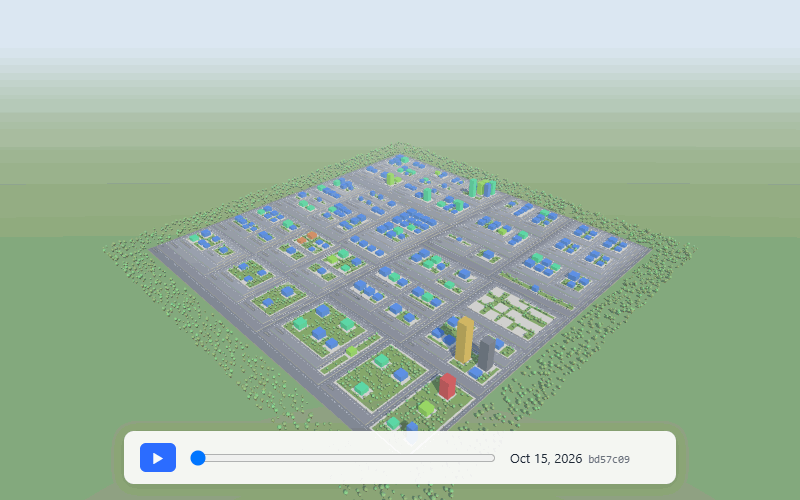
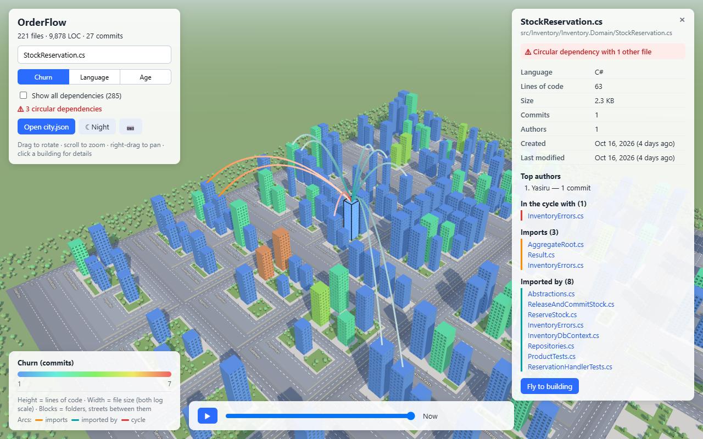
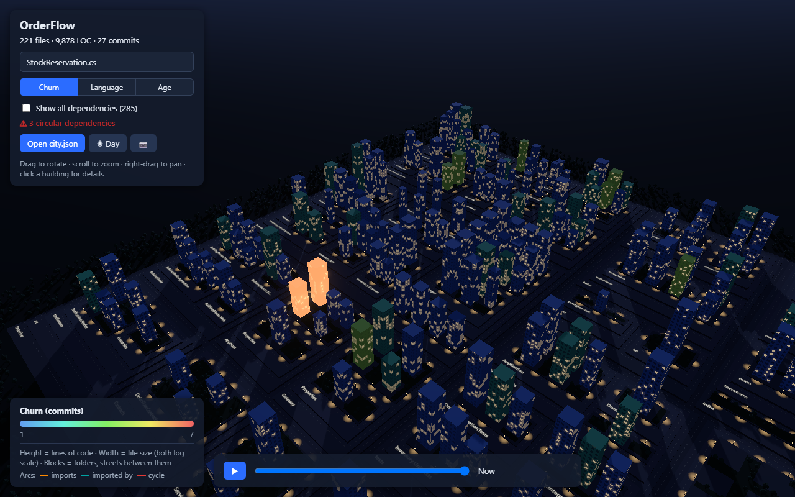
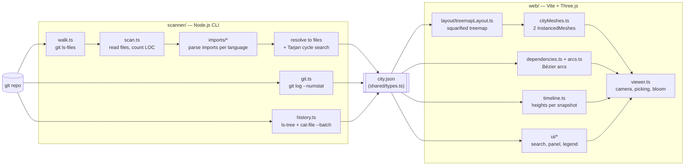

# CodeCity 3D

Turn any local git repository into an interactive 3D city — and watch it being built over time.



Every **file is a building**, every **folder is a district** of streets. Tall buildings have lots of
code, red ones change all the time, and arcs show who imports whom. The city looks like a real one —
windows, roads, parks, sky, street lamps at night — but every wall colour is still data.
No AI, no server, no internet: a small CLI scans the repo into a JSON file, and a static web page renders it.

| Dependencies of one file (orange = imports, teal = imported by, red = cycle) | Night mode: hot files glow |
| --- | --- |
|  |  |

## Quick start

Needs Node.js 20+ and git.

```bash
npm install
npm run build                      # bundles the scanner CLI and the web app

npx codecity scan ../my-repo -o samples/my-repo.json --history
npm run dev                        # open http://localhost:5173/?city=my-repo.json
```

You can also drag any `city.json` onto the page, or use **Open city.json**.

### CLI

```
codecity scan <repo-path> [-o city.json] [--history [points]]
```

| Option | What it does |
| --- | --- |
| `-o, --output <file>` | Where to write the JSON (default `city.json`) |
| `--history [points]` | Also sample git history for the timeline (default 30 points, evenly spread in time) |

## The city metaphor

| City | Code |
| --- | --- |
| Building | One source file |
| Height | Lines of code (non-blank), log scale |
| Footprint | File size, log scale |
| Colour | Switchable: **churn** (commits, blue → red), **language**, or **age** (last change, purple → orange) |
| District | A folder: an asphalt block with streets between its sub-folders; nested folders sit a little higher |
| Sidewalk | Where a folder's own files stand |
| Parks | Leftover space (no data — just room the layout didn't need) |
| Arcs | Imports between files (JS/TS, Python, C#); red = circular dependency |
| Timeline | The repo at points in its git history; buildings grow, appear and vanish |

**Controls:** drag to rotate · scroll to zoom · right-drag to pan · hover for a tooltip ·
click a building for details · search to fly to a file · Esc to clear · `?debug` in the URL shows FPS and draw calls.

## Architecture



The JSON file is the contract between the two halves (`shared/types.ts`), so each side can be
built and tested on its own.

### How it works

- **File list** — `git ls-files --cached --others --exclude-standard` lets git apply every
  `.gitignore` rule; folders that aren't repos fall back to a disk walk with the `ignore` package.
  Binary files are detected by a zero byte in the first 8 KB.
- **Git stats** — one `git log --numstat` for the whole repo, streamed line by line, instead of one
  `git log` per file.
- **Layout** — a nested [squarified treemap](https://www.win.tue.nl/~vanwijk/stm.pdf): rows are grown
  along the shorter side while that makes the worst aspect ratio better. A folder's own files are
  grouped into one "lot", and tiny blocks next to huge siblings get a minimum share, so no building
  is squeezed into a sliver.
- **Imports** — regex parsers (comments stripped first) for JS/TS, Python and C#, separated from the
  resolvers so they could be swapped for Tree-sitter. C# `using`s import namespaces, so a file only
  links to files that declare a type it actually mentions (and parts of a `partial class` aren't linked
  to each other).
- **Cycles** — Tarjan's strongly-connected-components algorithm, written without recursion so a
  50,000-file import chain can't overflow the stack.
- **History** — commits are sampled evenly in time along `--first-parent`; `git ls-tree` lists each
  snapshot and one long-running `git cat-file --batch` reads file contents. A blob ID is a hash of the
  content, so each unique version is counted once across all snapshots. Every file that ever existed is
  laid out, so buildings never jump around while you scrub the timeline.
- **Rendering** — everything repeated is an `InstancedMesh` (one draw call for all buildings, one for
  all blocks, one for all trees…). Hover, selection and night-time glow are a per-instance `glow`
  attribute added to the standard shader. Bloom is `UnrealBloomPass`, used only at night.
- **Realistic look, at no object cost** —
  - **Windows** are a procedural texture: the building shader works out per pixel whether it's glass
    or wall from its position on the building, and fades the pattern when windows get smaller than a
    few pixels (no shimmering). At night a hash picks which windows are lit.
  - **Streets** come from the treemap itself: every cell is shrunk by half a road width, so a street
    opens between neighbours with the old shared edge as its centre line.
  - **Parks** fill free sidewalk space (a grid scan clear of buildings), within a tree budget.
  - **Sky** is a shader dome (gradient, sun/moon, stars); the same sky rendered with `PMREMGenerator`
    is the environment map that gives glass its reflections and the city its soft sky light.
  - **Street lamps** are fake lights: glowing heads plus an additively blended pool of light on the road.

## Performance

Measured on a generated repo (`npm run make-test-repo`) with **10,041 files, 4.7 M lines,
24,125 imports and 30 commits over a year**, on Windows:

| | Result | Target |
| --- | --- | --- |
| Scan (files, LOC, git stats, imports, cycles) | 4.8 s | < 30 s |
| Scan with `--history 30` | 9.7 s | < 30 s |
| Draw calls for the whole city | ~205 (instead of 10,000+) | — |
| Frame rate, **software rendering** (no GPU, headless Chrome) | 46–56 fps | 60 fps |
| "Show all" with 24,125 arcs | built in 0.9 s, 35 fps (software) | — |

These frame rates were measured before the realistic look was added. Windows, streets and parks
cost no measurable frame rate; the sky reflections and street lamps cost about 10–15% in software
rendering (measured side by side). With a real GPU the frame rate is higher — open any city with
`?debug` to see FPS and draw calls on your machine. To reproduce:

```bash
npm run make-test-repo -- ../big-repo --files 10400 --commits 30
npx codecity scan ../big-repo -o samples/big.json --history
```

## Development

```bash
npm test             # 104 Vitest tests: LOC, git, history, imports, cycles, treemap, streets, parks, lamps…
npm run typecheck
npm run dev          # web app with hot reload
npm run scan -- <repo> -o samples/x.json   # run the scanner from source (no build needed)
```

```
codecity/
├─ shared/types.ts        the city.json schema
├─ scanner/               CLI: walk, loc, git, history, imports/, cycles
├─ web/                   Vite + Three.js viewer: layout/, ui/, viewer, cityMeshes, arcs, timeline
├─ samples/               example city files (served by the dev server)
├─ tools/make-test-repo.ts  generates a big fake repo for performance tests
└─ docs/                  README images
```

## Known limitations

- Imports are found with regular expressions. JS/TS path aliases other than `@/` and `~/` aren't
  read from tsconfig; C# fully-qualified names without a `using` aren't linked; Python imports inside
  `if TYPE_CHECKING:` count as normal imports.
- Renamed files show up as one building vanishing and another appearing.
- Deleted files keep an empty plot in today's city (the price of a stable layout over time).
- Only the 200 largest districts get a name label, to save GPU memory on big repos.
